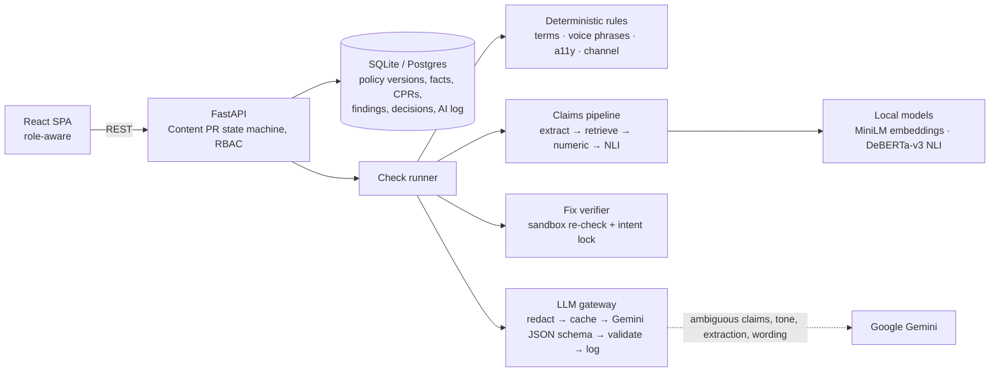

# Plumb: brand CI for everything a company publishes

Plumb is a pre-publication gate for brand content. Every draft is a **Content Pull Request**. It runs against the brand's compiled policy and its **Facts Ledger**, gets pass/warn/block checks with fixes that keep the writer's message, and can only ship after the right people sign off. Approval locks the version and issues a **signed audit receipt**.

Built for the CodeAxis Hackathon (We Code Coders) on the Inkloom AI brand-governance problem statement. Round 2 build: 22–25 October 2026.

**Live demo:** _link added after deployment_ · Demo brand: **Kora Naturals** (fictional skincare company)

---

## Try it in two minutes (no sign-in)

1. Open the live demo. You start as **Bluefin Studio**, an agency creator.
2. On Home, click **Instagram launch caption**. Plumb checks it in a few seconds and flags 4 blockers:
   - "100% natural" contradicts ledger fact **F-07** (96% naturally derived)
   - "eco-friendly" is a vague green claim (**§5.1**, mirrors CCPA 2024 greenwashing guidelines)
   - "India's #1 dermatologist-recommended" has no evidence (**§5.3**)
   - "₹299" is an **expired** launch price (F-15 ended 30 Sep 2026; F-22 says ₹349)
3. Click any highlighted phrase to see the rule or fact behind it. Click **Apply all verified fixes**. Version 2 is re-checked automatically and passes.
4. Click **Submit for review**. The draft makes claims, so it is routed to **both** the brand manager and the claims reviewer.
5. In the sidebar, switch to **Meera Iyer** (brand) and approve, then to **Rohan Shah** (claims) and approve.
6. An **audit receipt** appears. Click **Verify signature**.

Also try: **Brand policy → Use the October 2026 update → Compile into rules** as Meera, approve the proposed rules and publish v3. Open drafts then ask to be re-checked, and the new rules fire. Or go to **Facts ledger → Expire now** as Rohan and see which drafts are affected.

---

## What works in Round 2

| Area | What's built |
|---|---|
| **Guidelines → rules** | Import PDF, DOCX, Markdown or pasted text. An LLM proposes typed rules, with a deterministic parser as fallback. **Every rule must quote its source sentence, or it is dropped.** Brand manager approves, rejects or re-grades each rule. Publishing creates a versioned policy snapshot with a diff. |
| **Facts Ledger** | Approved facts with owner, evidence, approved wording and a validity window. Statuses are computed (active, expired, scheduled). "Where it's used" shows impact, and one click re-checks affected drafts. |
| **Checks** | Terminology (banned and preferred terms, brand and product names, fairness language), voice (pressure, jargon, skin-shaming, gendered defaults), claims (environmental, health, superlative, price, statistic), accessibility (reading grade, ALL-CAPS, exclamations, link text, alt text, emoji) and channel rules (ASCI influencer disclosure, character limits). |
| **Claims verification** | Claim extraction, then embedding retrieval, then **exact numeric comparison** (₹, %, lakh/crore, counts with units), then **DeBERTa-v3 NLI** entailment, with an **LLM judge only for the ambiguous remainder**. Verdicts are supported, contradicted, expired (with the replacement fact) or unsupported. |
| **Explainability** | **No citation, no finding.** Each finding cites a rule in the current policy version, plus a ledger fact for claims, and quotes the source text. Uncited model output is discarded and counted. |
| **Intent-locked fixes** | Goal, audience, CTA and must-keep phrases are extracted, and the creator confirms them. Each fix is applied in a sandbox and re-checked. It is offered as *verified* only if the issue disappears, no new blocker appears, and the intent survives. |
| **Review workflow** | Content PRs with versions and word diffs. Accept, edit or dispute per finding. Disputes and overrides need written reasons. Claim-aware routing (brand manager always, claims reviewer when the draft makes claims). Approve or request changes. The publish gate blocks submission with open blockers or after a policy change until re-checked. |
| **Audit receipts** | HMAC-SHA256 signed JSON covering the version hash, policy version, ledger snapshot hash, checks, claims, every human decision, approvals and AI calls. A verify endpoint detects any tampering. |
| **Roles & privacy** | Server-side RBAC for creator, brand manager, claims reviewer and admin. Creators only see their own drafts. A single LLM gateway redacts emails, phones, PAN, Aadhaar, card numbers and workspace confidential terms before any external call. **Confidential drafts never reach an external model.** |
| **AI disclosure log** | Every model call, or skipped call, is logged with purpose, provider, model, redaction count, prompt hash and latency. The log is shown per draft and workspace-wide. |
| **Formats** | Pasted text, DOCX, PDF (text layer, reflowed), Markdown and TXT. |

## Architecture



One container serves the API, the built frontend and the local models (baked into the image).

### Technology choices

| Layer | Choice | Why |
|---|---|---|
| Frontend | React 19 + TypeScript + Vite + Tailwind v4 | A static SPA served by the API, so judges get one URL and there is no SSR to break. Findings are anchored to exact character spans. |
| Backend | FastAPI (Python 3.12) | The NLP and document libraries are Python. Pydantic validates every request and every LLM response. |
| Data | SQLAlchemy over SQLite (WAL) | Zero external dependencies on the demo host. `DATABASE_URL` switches to Postgres unchanged. |
| Retrieval | `sentence-transformers/all-MiniLM-L6-v2` | Small and CPU-fast. The ledger is small, so cosine search in NumPy beats running a vector DB. |
| Entailment | `cross-encoder/nli-deberta-v3-small` | Local, deterministic, free. It decides most non-numeric claims so the LLM isn't the source of truth. |
| LLM | Google Gemini via REST, strict `responseSchema` JSON | Structured output makes "must cite a valid rule or fact" checkable in code. Responses are cached per prompt hash, and the model has a fallback chain. |
| Documents | PyMuPDF, python-docx | Reliable text extraction. Wrapped PDF lines are reflowed into clauses. |

## Reliability: measured, not claimed

The golden set is **53 hand-labelled drafts** in `backend/eval/golden.py`, labelled by the written policy rather than by engine behaviour. CI runs it on every push in offline mode (rules + local models, no external LLM):

| | Precision | Recall |
|---|---|---|
| **Blocking findings** | **1.00** | **0.96** |
| All findings | 1.00 | 0.92 |
| Claims & facts | 1.00 | 0.95 |
| Terminology | 1.00 | 1.00 |
| Voice | 1.00 | 0.89 |
| Accessibility | 1.00 | 0.71 |
| Channel rules | 1.00 | 1.00 |

- Citation validity is 100%, and deterministic runs are identical (checked by running every case twice).
- Known misses are kept in on purpose: "dermatologist recommended" and "decide fast" need the LLM pass. ALL-CAPS inside a flagged pressure phrase is reported once rather than twice.
- **Caveat:** we wrote the golden set ourselves, so these are upper bounds. A blind external set is part of the Round 3 plan.

Tests: **28 backend tests** (engine, API journeys, RBAC, gates, receipts, redaction, and LLM-output validation against a fake Gemini) and **3 browser end-to-end tests** (the full three-role journey, policy import, and role-based UI).

## Changes from the Round 1 plan

| Plan | Built | Why |
|---|---|---|
| Next.js + Vercel, FastAPI on Render | One Docker container (FastAPI serves the React build) on a Hugging Face Space | One judge-facing URL, no cold-start chain across two hosts, and 16 GB RAM so the NLI model runs on CPU. |
| Postgres + pgvector (Supabase) | SQLite + in-memory cosine search; Postgres-ready via `DATABASE_URL` | The ledger has tens of facts, not millions. This removes an external dependency that could fail during judging. |
| Redis + arq queue | FastAPI background tasks with persisted progress | Same async UX (live step-by-step progress) with one less service. |
| Microsoft Presidio redaction | Regex redactor (email, phone, Aadhaar, PAN, card) + workspace confidential-term list | Presidio's spaCy model adds about 500 MB. The patterns that matter for Indian marketing content are covered, and the redaction is tested. |
| TipTap editor | Read-only annotated draft + plain editor that saves new versions | Findings anchor to immutable versions, which keeps the audit trail exact. |
| Image checks in Round 3 | Unchanged: still Round 3 | Kept the scope. Uploads reject images with a clear message. |
| (not planned) | Deterministic guideline parser as LLM fallback; signed receipts with a verify endpoint; fact impact + re-check | Added because they make the core workflow work without an API key and make approvals verifiable. |

## Round 3: three major improvements

1. **Ambiguity Radar: the guidelines get reviewed too.** Disputes, overrides and reviewer disagreements are already stored per rule (`decisions` table). Round 3 aggregates them, flags clauses that are disputed or applied inconsistently across authors, shows the conflicting examples, and drafts a clearer amendment for the brand manager to adopt as the next policy version. It will also add recurring-mistake insights by team, channel and author type (human, agency, AI, influencer).
2. **Visual governance for images and creatives.** Image upload with OCR so all text checks apply to text in images. Also: dominant-palette extraction with CIEDE2000 ΔE distance to brand colour tokens (§4.1), WCAG contrast on text over images (§4.2), logo-variant matching with clear-space checks, and alt-text generation. Every check reports a measurable value.
3. **Confidential mode with a local LLM, plus published blind reliability.** Today, confidential drafts skip AI judgment entirely. Round 3 routes them to a local open-weight model so they get full checks without leaving the server. We will also add an external, blind-labelled evaluation set and publish per-check precision and recall for both offline and LLM modes in CI.

## Responsible design

- **Humans decide.** AI never approves, never edits the policy, and never applies a fix. Voice findings can warn but never block. Blocking claim findings can only be overridden by the claims reviewer, with a written reason.
- **Privacy.** One gateway for all model calls, with redaction before sending and restoration after. Confidential drafts make zero external calls (this is tested). No real company data is used: Kora Naturals is fictional.
- **Transparency.** There is a per-draft and workspace AI disclosure log. The UI labels what came from rules, the local NLI model and AI judgment, with confidence where relevant.
- **Security.** Server-side RBAC on every endpoint. Uploads are size- and type-limited. Error messages don't leak stack traces. Receipts are HMAC-signed. The API key lives only in the host secret store.
- **Accessibility of Plumb itself.** Keyboard-navigable marks and dialogs, visible focus, severity shown as text as well as colour, `prefers-reduced-motion` respected, and responsive down to phone width.

## Run locally

```bash
# backend
python -m venv .venv && . .venv/bin/activate
pip install torch --index-url https://download.pytorch.org/whl/cpu
pip install -r backend/requirements-dev.txt
cd backend && GEMINI_API_KEY=... uvicorn app.main:app --port 8000   # key optional

# frontend (dev)
cd frontend && npm ci && npm run dev    # http://localhost:5173, proxies /api

# tests
cd backend && python -m pytest -q && python -m eval.run_eval
```

Docker: `docker build -t plumb . && docker run -p 7860:7860 -e GEMINI_API_KEY=... plumb`

Environment variables: `GEMINI_API_KEY`, `GEMINI_MODEL` (default `gemini-2.5-flash`), `PLUMB_LLM_DISABLED`, `DATABASE_URL`, `PLUMB_RECEIPT_SECRET`, `PLUMB_TODAY` (pin the date for tests).

## Disclosure

- **AI assistance:** this project was built with an AI coding assistant (Anthropic's Claude), as permitted by the event rules. Commits made with it carry a `Co-Authored-By` trailer. The participant directed the product, reviewed the output and is responsible for it.
- **Templates and boilerplate:** the frontend started from the standard `npm create vite` React + TypeScript template. There is no other pre-existing code. Everything was written inside the build window (see commit history from 22 Oct 2026, 10:00 IST).
- **External services:** Google Gemini API (optional, through the gateway) and Hugging Face Hub (model download at image build time).
- **Models:** `sentence-transformers/all-MiniLM-L6-v2` (Apache-2.0) and `cross-encoder/nli-deberta-v3-small` (Apache-2.0).
- **Libraries:** FastAPI, SQLAlchemy, Pydantic, httpx, PyMuPDF, python-docx, NumPy, PyTorch, Transformers, sentence-transformers, React, React Router, jsdiff, Tailwind CSS, and Fontsource (Schibsted Grotesk, Source Serif 4, JetBrains Mono, all OFL).
- **Data:** the Kora Naturals brand, guidelines, facts and drafts are fictional and written for this demo. Regulatory references (ASCI influencer guidelines, CCPA 2024 greenwashing guidelines) are cited for context only.

## Team

**PG6189** (solo): **Parthiv Gopa**, B.Tech CSE (AI & ML), SRM Institute of Science and Technology. Product, check engine, backend, frontend, evaluation and deployment.
